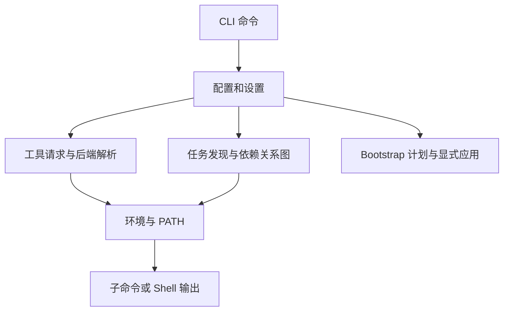

# 代码库架构

修改某项行为前，可先通过本图找到负责该行为的代码。有关环境设置、检查和提交更改的方法，请参阅[贡献指南](/contributing.html)。

## 库、二进制程序与 crate {#library-binary-and-crates}

`mise` 包会构建两个目标。库 `src/lib.rs` 包含命令行以外的所有功能：配置、工具集、后端、任务、环境和 bootstrap。二进制程序由 `src/main.rs` 和 `src/cli/` 组成，构建在库之上。`src/main.rs` 通过 `use mise::*` 导入库的根模块，因此 `src/cli/` 中的代码仍可写作 `crate::config::…`。只修改 `src/cli/` 时，只需重新编译二进制程序。

库代码不得引用 `crate::cli`。核心代码需要命令行行为时，应调用 [`src/frontend.rs`](https://github.com/jdx/mise/blob/main/src/frontend.rs) 中的 hook；二进制程序启动时通过 `cli::register_frontend` 填入这些 hook。它们用于在安装新增版本后运行 `mise lock`，以及列出子命令名称以生成“你是不是想输入……”建议。若 `cli` 需要访问核心项，请将该项设为 `pub`。库会拒绝 `unreachable_pub`，因此其他内容都应保持为 `pub(crate)`。

二进制程序的测试会设置 `cfg(test)`，但这些测试调用的库不会设置。因此，核心代码若需在测试期间采取不同的行为，应改为检查 `mise_util::testing::in_tests()`。

`crates/` 下的 workspace crate 不能依赖 `mise` 包。`src/lib.rs` 中的 `register_util_hooks` 会在其他代码运行前，为它们提供所需的 mise 功能，例如设置加载器和用于缓存键的构建标识。

| Crate                     | Contents                                                                                                   |
| ------------------------- | ---------------------------------------------------------------------------------------------------------- |
| `mise-util`               | 环境、目录、文件、HTTP、缓存、模板以及 `EnvDiff`/`PathEnv` 辅助功能                                         |
| `mise-daemons`            | 守护进程声明、端口、预设和 supervisor 运行时（toolset 集成代码仍位于 `src/daemons/`）                    |
| `mise-oci`                | OCI registry 客户端、镜像层和镜像布局（镜像构建器仍位于 `src/oci/`）                                     |
| `mise-system`             | bootstrap、dotfiles 和历史记录模块                                                                        |
| `mise-config`             | `mise.toml` 声明类型，目前包括 `[bootstrap]`、`[dotfiles]` 和 `[history]`                                 |
| `mise-system-packages`    | 系统包管理器驱动，包括 apt、dnf、brew、brew-cask 等                                                        |
| `mise-ui`                 | 终端进度报告、提示和主题                                                                                   |
| `mise-settings`           | 根据 `settings.toml` 生成的 `Settings` 类型，以及进程级设置缓存                                              |
| `vfox`                    | 内嵌 Lua 运行时，以及 vfox 插件使用的 hook 和模块接口                                                        |
| `aqua-registry`           | aqua registry 的解析、软件包查找和缓存格式                                                                  |
| `mise-bootstrap`          | Bootstrap 资源规划和依赖排序                                                                                |
| `mise-cache-core`         | 远程任务缓存协议、内容寻址存储、身份验证和传输                                                               |
| `mise-shim`               | `mise-shim.exe`：Windows shim 在默认 `exe` 模式下使用的原生可执行文件                                      |
| `mise-sigstore`           | Sigstore 验证辅助功能                                                                                       |
| `mise-agent-env`          | 根据进程环境检测 AI 编码代理                                                                                 |
| `mise-interactive-config` | `mise edit` 使用的交互式 TOML 编辑器                                                                         |
| `mise-brew-metadata`      | Homebrew formula 元数据模型                                                                                  |
| `mise-brew-relocation`    | Homebrew bottle 占位符替换和二进制重定位                                                                    |
| `mise-dotenv`             | 可明确控制变量替换行为的 dotenv 解析器                                                                        |

## 代码位置 {#where-things-live}

| 功能                                      | 代码                                                                                                               | 用户文档                                         |
| ---------------------------------------- | ------------------------------------------------------------------------------------------------------------------ | ------------------------------------------------ |
| 命令、标志和帮助文本                     | `src/cli/`；`mod.rs` 负责分发，每条命令都有对应文件或目录，例如 `use.rs`、`exec.rs` 或 `tasks/`              | [CLI 参考](/cli/)                                |
| 各命令会修改的内容                        | `src/cli/command_effects.rs`                                                                                       |                                                  |
| 配置发现、加载和合并                      | `src/config/`；`config_file/` 包含 `MiseToml`、`ToolVersions` 和 `IdiomaticVersionFile`                            | [mise.toml](/configuration.html)                 |
| 设置                                      | `settings.toml` 生成到 `crates/mise-settings`；加载、信任和 CLI 标志位于 `src/config/settings.rs`                | [设置](/configuration/settings.html)             |
| 配置文件 schema                           | `schema/mise.json`                                                                                                 | [mise.toml](/configuration.html)                 |
| 工具请求、解析和安装状态                  | `src/toolset/`                                                                                                     | [开发工具](/dev-tools/)                          |
| 后端                                      | `src/backend/`；`Backend` trait 位于 `mod.rs`，`BackendType` 位于 `backend_type.rs`                                | [后端](/dev-tools/backends/)                     |
| 内置工具                                  | `src/plugins/core/`                                                                                                | [内置工具](/core-tools.html)                      |
| 插件                                      | `src/plugins/`（asdf 和 vfox 适配器）以及 `crates/vfox`                                                            | [插件](/plugins.html)                             |
| 工具简称                                  | `registry/*.toml` 由 `build.rs` 编译；在 `src/registry.rs` 中查找                                                  | [注册表](/registry.html)                          |
| aqua registry                             | `crates/aqua-registry`；随附快照位于 `vendor/aqua-registry/`，由 `build.rs` 编入                                   | [aqua](/dev-tools/backends/aqua.html)             |
| 锁文件                                    | `src/lockfile.rs` 和 `src/lockfile/`                                                                              | [锁文件](/dev-tools/mise-lock.html)              |
| 环境指令                                  | `src/config/env_directive/`；`EnvDiff` 和 `PathEnv` 来自 `crates/mise-util`                                        | [环境变量](/environments/)                        |
| Shell 激活                                | `src/shell/`（每种 shell 一个文件）、`src/hook_env.rs`、`src/cli/activate.rs`                                       | [Shell 设置](/shell-setup.html)                   |
| Shims                                     | `src/shims.rs` 和 `crates/mise-shim`                                                                              | [Shims](/dev-tools/shims.html)                    |
| 模板                                      | `crates/mise-util/src/tera.rs`，并通过 `src/tera.rs` 重新导出                                                     | [Tera 模板](/templates.html)                      |
| 任务                                      | `src/task/`                                                                                                        | [任务](/tasks/)                                   |
| 远程任务缓存                              | `crates/mise-cache-core`                                                                                           | [远程任务缓存](/tasks/remote-cache.html)          |
| Bootstrap 和主机软件包                   | `src/cli/bootstrap.rs`、`crates/mise-system`（软件包位于 `crates/mise-system-packages`）、`crates/mise-bootstrap` | [Bootstrap](/bootstrap.html)                      |
| Dotfiles                                  | `src/cli/dotfiles/`、`crates/mise-system/src/managed_files.rs`、`crates/mise-system/src/history/`                  | [Dotfiles](/dotfiles.html)                        |
| 守护进程                                  | `src/daemons/`（工具集集成代码）、`crates/mise-daemons`                                                            | [守护进程](/daemons.html)                          |
| 项目依赖                                  | `src/deps/`                                                                                                        | [项目依赖](/dev-tools/deps.html)                  |
| 密钥                                      | `src/secrets/`、`src/sops.rs`、`src/agecrypt.rs`                                                                   | [密钥](/environments/secrets/)                    |
| 缓存                                      | `crates/mise-util/src/cache.rs`：`CacheManager<T>` 使用 MessagePack 和 zlib，并以原子方式写入                      | [缓存](/cache-behavior.html)                      |
| packslip 清单                             | `src/packslip.rs`、`src/backend/packslip.rs`                                                                       | [packslip](/dev-tools/backends/packslip.html)     |
| OCI 镜像                                  | `src/oci/`（构建器）、`crates/mise-oci`                                                                            | [OCI 镜像](/dev-tools/mise-oci.html)              |
| OpenTelemetry                             | `src/otel/`                                                                                                        | [OpenTelemetry](/tasks/opentelemetry.html)        |
| Identity 安装布局                         | `src/install_layout/`                                                                                              | [安装布局](/dev-tools/install-layout.html)        |
| 沙箱                                      | `src/sandbox.rs`                                                                                                   | [沙箱](/sandboxing.html)                          |
| 自我更新                                  | `src/cli/self_update.rs`                                                                                           | [mise 打包](/packaging.html)                      |

## 命令的运行流程 {#system-overview}

大多数命令会加载配置、解析其中请求的工具、据此构建环境，然后运行子进程或输出 Shell 代码。任务和 bootstrap 也从同一份配置开始。

### 配置 {#configuration-system}

[`src/config`](https://github.com/jdx/mise/tree/main/src/config) 会查找配置文件，通过 `ConfigFile` trait 加载并合并它们。代码会分别决定查找哪些文件、文件是否受信任，以及各字段如何合并。设置、工具、环境指令、任务和 bootstrap 条目采用不同的合并方式；写入命令也会单独选择[目标文件](/configuration.html#target-file-for-write-operations)。

### 工具集 {#toolset-management}

[`src/toolset`](https://github.com/jdx/mise/tree/main/src/toolset) 将版本请求关联到已解析的版本和安装状态：

| 类型             | 作用                                                                                  |
| ---------------- | ------------------------------------------------------------------------------------- |
| `ToolRequest`    | 工具版本请求，例如 `node@24`、某个 channel 或 ref，并包含其后端和选项                   |
| `ToolVersion`    | 已解析的版本及其安装元数据                                                            |
| `Toolset`        | 当前上下文中的请求和已解析版本                                                        |
| `ToolsetBuilder` | 合并配置、环境变量覆盖项和命令行参数，然后解析工具                                    |

### 后端 {#backend-system}

[`Backend` trait](https://github.com/jdx/mise/blob/main/src/backend/mod.rs) 将通用策略与后端专属工作分开。它的公开包装方法负责缓存和解析。后端需要实现 `_list_remote_versions`（返回 `VersionInfo` 条目）和 `install_version_` 等 hook。`src/plugins/core/` 中的内置工具也实现了同一 trait。mise 如何为简称选择后端，请参阅[后端选择机制](/dev-tools/backends/#how-backend-selection-works)；添加后端的方法见[添加后端](/contributing.html#adding-backends)。

### 插件 {#plugins}

[`src/plugins`](https://github.com/jdx/mise/tree/main/src/plugins) 负责安装插件源并记录其元数据。
[`crates/vfox`](https://github.com/jdx/mise/tree/main/crates/vfox) 在内嵌 Lua 运行时中运行 vfox 插件。工具插件负责安装单个工具，后端插件处理 `plugin:tool` 请求，环境插件返回变量和 `PATH` 条目，软件包插件则批量管理主机软件包。asdf 适配器会运行旧式 Shell 脚本。安装或更新插件源与安装工具版本是彼此独立的操作，各自维护状态。详见[插件](/plugins.html)。

### 任务 {#task-system}

[`src/task`](https://github.com/jdx/mise/tree/main/src/task) 负责发现、调度并运行任务。`Task` 保存任务定义；`task_file_providers/` 中的 provider 加载本地和远程任务文件；`Deps` 表示依赖关系图；executor 和 scheduler 则按配置的并发度与输出样式运行已就绪的任务。图中的每个节点都包含任务、参数、环境变量和运行阶段，因此同一任务使用不同参数时会成为不同节点。更改依赖图的构建方式，或修改 `depends`、`depends_post` 和 `wait_for` 的行为前，请阅读[依赖与执行顺序](/tasks/architecture.html)。

### 环境与 Shell 激活 {#shell-integration}

`src/config/env_directive` 会解析 `[env]` 指令。标记为 `tools = true` 的指令在工具解析后运行，其余指令则在解析前运行。`mise activate` 会从 `src/shell/` 输出 Shell hook，在每次显示提示符时运行 `mise hook-env`。`hook-env` 会记录 `EnvDiff`，以便下一次运行先撤销上一个目录的环境更改，再应用新更改。`mise exec` 和 `mise run` 会直接构建子进程环境，因此不需要激活。

### Bootstrap 与主机状态 {#bootstrap-and-host-state}

`src/cli/bootstrap.rs` 会构建计划并运行选定阶段。`crates/mise-system` 中的代码管理软件包、文件、编辑操作、仓库、服务和特定平台的资源；这些内容都位于工具安装目录之外。状态检查、预览、应用和清理是不同操作：状态检查只读取主机，不会修改任何内容。命令行可以指定软件包批次的子集，因此批次中缺少某个软件包并不表示要将其删除。

## 必须遵循的规则 {#rules-to-preserve}

- 将版本视为不透明字符串。通过后端解析请求（`Backend::latest_version`、`Backend::list_versions_matching`、`ToolRequest::resolve`），不要在新的调用点使用 semver 排序。
- 使用 `==` 比较锁文件版本，保留条目的后端和校验和，绝不要将 `latest`、`lts/*` 或版本前缀写入锁文件。
- 只报告本地状态的代码路径不得新增安装或网络请求。
- 子进程环境应根据 mise 计算出的环境构建，而不是继承进程环境；后者可能缺少先前的环境指令，或选择错误的工具。
- 缓存键必须包含所有会改变缓存结果的输入，例如选项、环境变量和来源元数据。环境缓存（`src/toolset/env_cache.rs`）和任务缓存（`src/task/task_cache.rs`）不使用 `CacheManager`，有各自的格式和失效规则。
- 在 mise 内部和子进程中，Windows 的 `PATH` 必须保持原生格式。只有向正在运行且已明确识别为 MSYS2 或 Cygwin 的 Shell 输出赋值语句时，才转换格式；完整规则见[代理指南](https://github.com/jdx/mise/blob/main/AGENTS.md)。
- 在 `src/cli/command_effects.rs` 中为每条新命令分类；详见[修改 CLI 命令](/contributing.html#changing-a-cli-command)。

## 生成文件 {#generated-files}

修改源文件后重新生成，并将生成结果与产生它的更改一并提交。

| 输出                                                                    | 来源                                                                                                                                                    | 重新生成命令                                   |
| ---------------------------------------------------------------------- | -------------------------------------------------------------------------------------------------------------------------------------------------------- | --------------------------------------------- |
| `mise.usage.kdl`、`docs/cli/`                                           | `src/cli/` 中的命令定义、`src/assets/mise-extra.usage.kdl` 和 `docs/.vitepress/cli-reference.ts`                                                        | `mise run render:usage`                       |
| `tasks.md`                                                             | 项目在 `tasks.toml`、`xtasks/` 和 `mise.toml` 中定义的任务，通过 `mise generate task-docs` 生成                                                        | `mise run render:usage`                       |
| `man/man1/mise.1`                                                      | `mise.usage.kdl`                                                                                                                                         | `mise run render:mangen`                      |
| `completions/`                                                         | 使用说明规范，通过 `mise completion <shell>` 生成                                                                                                        | `mise run render:completions`                 |
| `docs/.vitepress/cli_commands.ts` 和惯用版本文件表                      | `src/cli/` 以及 `registry/*.toml` 中的 `idiomatic_files` 键                                                                                              | `mise run render:help`                        |
| `schema/mise.json`、`schema/mise-task.json`、`schema/miserc.json`      | `crates/mise-config` 中的类型和文档注释（顶层使用 `MiseTomlDecl`），以及 `settings.toml`；通过 mise-config 的 `render-schema` 示例生成               | `mise run render:schema`                      |
| `docs/public/llms.txt`                                                 | 页面标题、导语和 `docs/.vitepress/sidebar.ts`                                                                                                            | `mise run render:llms`                        |
| `Settings` 类型                                                        | `settings.toml`                                                                                                                                          | 每次构建（`crates/mise-settings/build.rs`）    |
| 编译进 mise 的注册表                                                   | `registry/*.toml`                                                                                                                                        | 每次构建（`build.rs`）                        |
| [设置参考](/configuration/settings.html)                               | `settings.toml`                                                                                                                                          | 每次文档构建                                   |

`mise run render` 会运行所有 `render:*` 任务。对于 schema，请修改 `crates/mise-config` 中的类型和文档注释，而不是直接编辑 JSON；提交文件未更新时，`mise-config` 测试会失败。

## 测试 {#tests}

单元测试与被测代码放在一起；E2E 测试是 `e2e/` 下的 Bash 脚本，通过 `mise run test:e2e` 运行；`e2e-win/` 下的 Windows E2E 测试使用 Pester。运行命令和前置条件见[测试](/contributing.html#testing)。
