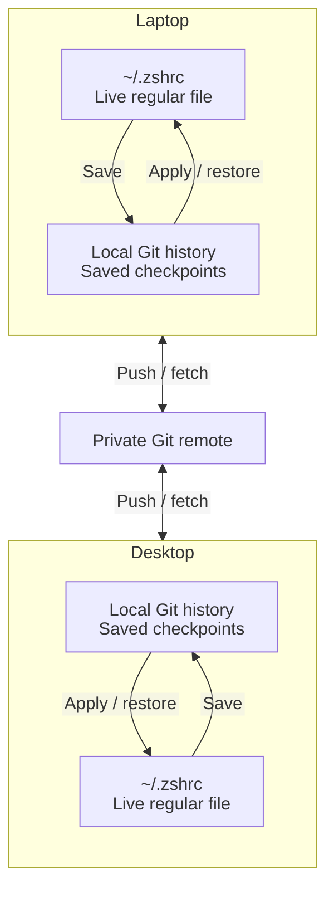

# 跨机器同步

连接一个私有 Git 仓库（称为 origin）后，mise 会在使用该仓库的所有机器之间共享受跟踪文件的历史记录。你在笔记本电脑上保存的编辑会同步到台式机，台式机上的编辑也会同步回来。

每台机器上的文件仍保留在原位置。已保存的检查点通过 origin 传输，mise 会将传入的更改应用到其他机器上的受跟踪文件。`mise dot status` 和 `mise dot origin` 将 origin 称为 setup 仓库。



## 连接前须知 {#before-you-connect}

自动同步要求每台机器都运行[监视器](/dotfiles/history.html#automatic-saves)，并为监视器配置可用的 Git 凭据；参见[仓库身份验证](#repository-authentication)。

请先检查受跟踪文件及其早期检查点。连接后会共享完整历史记录，包括连接之前的中间保存；从当前文件中删除的密钥仍会保留在旧提交中。请使用私有仓库，并在首次保存需要加密的文件之前配置[加密](/dotfiles/encryption.html)。如果不想在共享历史中包含某个文件，就不要跟踪它；之后取消跟踪或排除文件，也不会删除它在历史中的早期版本。

## 连接 origin {#sharing-across-machines}

创建一个空的私有仓库，将 `you/setup` 替换为仓库名称，然后使用 [`mise dot origin set`](/cli/dotfiles/origin/set.html) 进行连接：

```sh
mise dot origin set https://github.com/you/setup.git --sync sync
mise dot status
```

任何 Git URL 都可使用，包括自托管服务器：

```sh
mise dot origin set git@gitea.example.com:you/setup.git --sync sync
```

The URL must not contain credentials, a query string, or a fragment.
Authenticate with an SSH agent, or with a Git credential helper for HTTPS.

Files that describe one machine, such as a monitor layout, should not be
applied on the others. Track them with a
[`machine` variant](/dotfiles/history.html#machine-variants) so each machine
keeps its own version.

mise prints a preview of the connection and then connects. Without `--sync`,
it asks which sync mode to use first, because `sync` lets the origin write your
live files. With `--sync sync`, the
watcher pushes saved changes and periodically fetches and applies changes from
other machines. mise uses the repository's default branch unless you pass
`--branch`; a repository with no branches gets `main`, which the first push
creates.

mise writes the connection to `[history.origin]` in your
`~/.config/mise/config.local.toml`, so it stays on this machine, and the mode
to the [`history.sync`](/configuration/settings.html#history.sync) setting.
`mise dot origin` shows what is connected, and `mise dot origin --remove`
disconnects; local checkpoints and fetched history stay.

To bring another machine into the same setup, follow
[Set up a machine](/bootstrap/setup.html#set-up-another-machine), which adopts
the repository with
[`mise bootstrap --adopt`](/bootstrap/from-repository.html#shared-dotfile-history).

### The origin and your global config {#origin-and-global-config}

The origin holds mise's history of your tracked files. `origin set` never pulls
or pushes a Git checkout on this machine, such as a `~/.config/mise` that you
adopted with
[`mise bootstrap --adopt`](/bootstrap/from-repository.html#global-mise-configuration);
keep that checkout in sync with Git yourself.

Give the origin a repository of its own. Connecting your global config
repository can put mise's history on its default branch, and from then on
`mise bootstrap --adopt` restores it as a setup repository instead of cloning
it into `~/.config/mise`. To keep the history in that repository anyway, put it
on a branch of its own as in [Keep your local checkpoints](#keep-local-checkpoints),
and adopt it on other machines with `mise bootstrap --adopt '<url>?ref=<branch>'`.
若要通过 origin 共享全局配置，请跟踪整个目录：运行 `mise dot track ~/.config/mise`。以 `.local.toml` 结尾的文件仍保留在各自机器上。

### Repository authentication {#repository-authentication}

Network commands use your Git configuration, including credential helpers,
SSH, and URL rewrites. For a private GitHub repository, install the GitHub CLI
globally through mise and configure its credential helper:

```sh
mise use -g gh
mise exec gh -- gh auth login --hostname github.com --git-protocol https --web
mise exec gh -- gh auth setup-git --hostname github.com
```

该助手会写入 `~/.gitconfig`。全局安装 `gh` 可确保后台监视器也能使用它。如果 Git 在服务环境中已经可以完成身份验证，则无需更改配置。

对于 SSH 远端，请优先使用受口令保护、并已加载到服务可访问的 SSH agent 中的密钥。如果无人值守同步需要无口令密钥，请使用仅限此仓库的部署密钥；只有需要由本机推送时才授予写入权限，并将私钥文件权限限制为仅当前用户可访问（例如 Unix 上的 `0600`，或 Windows 上的等效 ACL）。不要重复使用权限不受限制的个人密钥。

## 选择同步模式 {#choose-a-sync-mode}

[`history.sync`](/configuration/settings.html#history.sync) 设置用于控制监视器自动执行的操作：

| 模式         | 行为                                                                                                                                                                                                                            |
| ------------ | -------------------------------------------------------------------------------------------------------------------------------------------------------------------------------------------------------------------------------- |
| `sync`       | 在 [`history.sync_interval`](/configuration/settings.html#history.sync_interval) 指定的间隔内推送已保存的更改。每隔 [`history.fetch_interval`](/configuration/settings.html#history.fetch_interval) 指定的时间获取并应用传入的更改。|
| `manual`     | 继续在本地保存。只有运行 `mise dot sync` 和 `mise dot pull` 时才交换并应用更改。                                                                                                                                                 |
| `fetch-only` | 获取远端更改，但绝不推送；只有运行 `mise dot pull` 时才应用传入的更改。                                                                                                                                                           |

连接时可以使用 `--sync manual`、`--sync sync` 或 `--sync fetch-only` 选择模式；之后也可以通过 `mise settings history.sync=manual` 更改。如果没有指定 `--sync`，`origin set` 会询问是否启用自动共享；选择否时会使用 `manual`。指定 `--yes` 时会使用已配置的模式，默认是 `sync`，因此在脚本中请明确传入 `--sync`。

## 立即同步 {#sync-immediately}

这些命令在所有模式下均可运行；在 `fetch-only` 模式下，`sync` 只会获取更改：

```sh
mise dot sync
mise dot pull
```

[`mise dot sync`](/cli/dotfiles/sync.html) 会获取远端更改，并在 `fetch-only` 模式之外推送已保存的提交。它不会更改你的文件。[`mise dot pull`](/cli/dotfiles/pull.html) 会将已获取的更改写入受跟踪文件。在 `sync` 模式下，如果不想等到下次定时运行，可以手动执行这些命令。哪些情况下还需要运行 `mise dot apply`，参见[拉取与应用](#pull-and-apply)。

每次推送都会包含所有累积的提交，包括在 `manual` 模式下创建的中间保存。等待手动保存或监视器延迟保存的文件，会使用其最近一次保存的内容。

`pull` 会将整批传入文件一次性应用，包括配置及其使用的源文件；不能只拉取其中一部分。它不会安装工具或服务，也不会渲染模板。相关声明或源文件更改后，请运行 `mise bootstrap` 部署；如果只有 `[dotfiles]` 更改，则运行 `mise dot apply`。还原共享受跟踪文件的内容无需单独运行 `apply`。

与 `rollback`、`undo` 和 `mise dot apply` 一样，pull 会先保存检查点，记录写入的每个文件，然后运行对应的[重新加载命令](/dotfiles/history.html#reload-an-application-after-restoring-files)。可以通过 `mise dot undo` 撤销。文件会逐个写入；如果 pull 中断，请使用 [`mise dot recover`](/dotfiles/reference.html#recovery-details) 继续处理。

如果发生冲突或存在未保存的编辑，mise 会暂停推送以及对所有受跟踪文件应用传入更改，但本地保存和获取仍会继续。网络或身份验证失败时，自动同步会重试，间隔从 1 分钟逐渐增长到 1 小时。`mise dot status` 和 `mise doctor` 会显示最近一次错误。

## 拉取与应用 {#pull-and-apply}

`sync`、`pull` 和 `apply` 分别负责一项工作，操作对象也各不相同：

| 命令             | 读取                                 | 写入                                                                      |
| ---------------- | ---------------------------------- | ------------------------------------------------------------------------ |
| `mise dot sync`  | 远端和已保存的历史记录               | 仅写入已保存的历史记录，不会写入文件。                                    |
| `mise dot pull`  | `sync` 获取的历史记录                | 受跟踪文件，包括 `copy` 或 `template` 的源文件。                          |
| `mise dot apply` | `[dotfiles]` 和磁盘上的文件          | `[dotfiles]` 目标，包括编辑、权限更改和移除。                             |

各条目模式的行为如下：

| 条目模式           | `mise dot pull`                                 | `mise dot apply`                            |
| ------------------ | ----------------------------------------------- | ------------------------------------------- |
| `track`            | 将获取的版本写入受跟踪路径。                       | 不会更改文件内容。                           |
| `copy`、`template` | 不会复制或渲染。                                 | 将源文件复制或渲染到目标路径。               |

原位跟踪的路径是应用程序实际读取的文件，例如 `~/.bashrc`。模板或复制源文件与应用程序读取的文件路径不同，即使它也位于 `~/` 下。跟踪该源文件即可在机器间共享，然后通过 `apply` 将其部署到目标路径：

```toml
[dotfiles]
"~/.bashrc" = { mode = "track" }
"~/.dotfiles" = { mode = "track" }
"~/.gitconfig" = { mode = "template", source = "~/.dotfiles/gitconfig.tera" }
```

在另一台机器上保存对 `~/.dotfiles/gitconfig.tera` 的更改后：

```sh
mise dot sync    # 获取更改
mise dot pull    # 更新 ~/.bashrc 和 ~/.dotfiles/gitconfig.tera
mise dot apply   # 将模板渲染到 ~/.gitconfig
```

这里没有跟踪 `~/.gitconfig`，因此其自身的历史记录需要单独决定；参见[历史记录的内容](/dotfiles/history.html#explicit-tracking-and-exclusions)。如果只在本机编辑模板，只需运行 `mise dot apply`。在 `sync` 模式下，监视器会自动获取并拉取，但不会复制或渲染；因此传入的源文件更改后，请运行 `mise dot apply`。

## 解决冲突 {#resolve-a-conflict}

比较本机保存的版本与从仓库获取的版本：

```sh
mise dot status
mise dot conflicts ~/.zshrc
```

[`mise dot conflicts`](/cli/dotfiles/conflicts.html) 会输出统一差异，不会更改任何一方。传入 `--difftool` 可使用 Git 配置的差异工具打开对比；如果没有配置差异工具，则使用合并工具。传入 `--difftool --tool <name>` 可指定工具。

选择使用文件的远端版本，或保留本地版本：

```sh
mise dot pull --take-remote ~/.zshrc
mise dot pull --keep-local ~/.zshrc
```

要在一条命令中以相同方式解决所有冲突，请使用全局选项形式。随后可以通过 `--keep-local` 和 `--take-remote` 指定例外：

```sh
mise dot pull --take-remote-all
mise dot pull --take-remote-all --keep-local ~/.zshrc
mise dot pull --keep-local-all
```

`--keep-local-all` 要求所有保留的文件都已保存；如果存在未保存的编辑，请先运行 `mise dot save`。

要合并双方更改，请根据冲突差异编辑当前文件，显式保存合并后的文件（即使文件使用 `--no-autosave` 跟踪也适用），然后保留已保存的本地版本：

```sh
mise dot conflicts --difftool ~/.zshrc
mise dot save ~/.zshrc
mise dot pull --keep-local ~/.zshrc
```

mise 会记录每项决定，只有所有冲突都解决后才应用传入文件。继续前，它会再次检查计划；如果出现更新的本地或远端编辑，相应决定可能失效，这时需要重新选择。

无效的传入配置或不安全的本地路径也会阻止整批更改；`mise dot status` 和 `mise doctor` 会指出相关路径和最近一次成功应用的记录。有些冲突不能通过 `pull` 解决，例如跟踪或加密设置更改、未激活的平台变体，或存在多个 Git 合并基点的历史记录。对于这些冲突，`status` 会打印 Git 命令，供你在单独克隆的仓库中运行。

### 冲突通知 {#conflict-notifications}

同步冲突导致共享暂停时，mise 会显示桌面通知，并提示查看 `mise dot status`。一次暂停只会发送一次通知；同一暂停期间的重试不会重复通知，恢复后再次暂停则可能重新通知。通知仅涵盖同步冲突。监视器无法保存等其他问题只会显示在 `mise doctor` 和 `mise dot status` 中。

| 平台                                 | 要求                                                                                                                      |
| ------------------------------------ | ------------------------------------------------------------------------------------------------------------------------- |
| Linux                                | 已安装 `notify-send`                                                                                                      |
| macOS，官方发行版构建               | 首次询问时允许通知。mise 只有在发送首次通知后才会显示在“系统设置 > 通知”中。                                              |
| macOS，其他构建（例如 Homebrew）     | 不支持；连接 origin 时 mise 会发出警告                                                                                    |
| Windows，无头系统                   | 不支持；请使用 `mise dot status` 或 `mise doctor`                                                                         |

运行 [`mise dot notify`](/cli/dotfiles/notify.html) 可立即发送测试通知并响应 macOS 提示；如果无法显示通知，该命令也会报告原因。`mise doctor` 会报告通知能否正常发送。通知程序缺失或运行失败都不会中断历史记录或同步。要关闭通知：

```sh
mise settings history.notify=false
```

## 按机器标识提交 {#identify-commits-by-machine}

历史记录提交默认使用 `mise <mise@localhost>` 作为作者和提交者。要在共享历史中识别创建每个新提交的机器，请将以下内容添加到系统或全局配置：

```toml
[history]
git_email = "mise@{hostname}"
```

创建提交时，mise 会将 `{hostname}` 替换为机器的主机名，因此在 `work-mbp.local` 上保存时会使用 `mise <mise@work-mbp.local>`。此设置也适用于监视器提交和 mise 创建的合并提交。该值也可以是固定的电子邮件地址。它只影响新提交；已有提交会保留原有身份。

## 从使用符号链接的 dotfiles 仓库迁移 {#move-from-a-symlinked-repository}

通过 `mode = "symlink"` 将 dotfiles 链接到目标位置的 Git 仓库，与 `mise dot track` 保存历史记录的仓库是两个独立的 Git 仓库。`~/dev/dotfiles` 这样的检出目录保存文件本身；历史记录则保存在 mise 管理的裸仓库中，`mise dot status` 会在 Repository 下将其列为 Local history。因此，将 `mise dot origin set` 指向 dotfiles 检出目录的远程仓库，会连接两个无关历史记录，mise 会拒绝合并。

要将文件从符号链接改为跟踪状态：

1. 将符号链接替换为其指向文件的普通副本。跟踪符号链接只会保存链接本身，而不会保存文件内容。
2. 将声明该文件的条目替换为跟踪条目。跟踪条目不接受 `source`、`content` 或 `manifest`，因此也请一并移除这些配置：

   ```toml
   [dotfiles]
   "~/.bashrc" = { mode = "track" }
   ```

   也可以运行 `mise dot track ~/.bashrc`，这会保留现有条目，并将跟踪条目添加到 `~/.config/mise/conf.d/dotfiles-tracking.toml`。若采用此方式，请从你手动编辑的配置文件中移除重复条目。

3. 运行 `mise dot paths` 检查每个条目来自哪个配置文件，然后运行 `mise dot save`。

若要继续使用相同的远程仓库，请将本地历史发布到单独的分支，以免修改默认分支。先用 `mise dot status` 找到历史记录仓库，然后运行：

```sh
git --git-dir <local-history> push <url> refs/heads/main:refs/heads/mise-history
mise dot origin set <url> --branch mise-history
```

如果不需要将两者放在同一处，使用一个独立的空私有仓库会更简单。若要连接已有提交的 origin，请参阅[解决无关历史记录](#resolve-unrelated-histories)。

## Resolve unrelated histories {#resolve-unrelated-histories}

如果本地检查点与 origin 分支没有共同的 Git 历史，`mise dot origin set` 和 `mise dot sync` 会拒绝合并。即使文件内容完全相同，也不会替换任一方的历史记录。重试前，请先选择要保留哪一方的历史。

### 保留本地检查点 {#keep-local-checkpoints}

连接一个空仓库：

```sh
mise dot origin set <empty-repository-url>
```

若要改用现有仓库，请先使用 Git 将本地历史记录推送到其中的新分支（`mise dot status` 会将其路径列为 Local history），然后连接该分支：

```sh
mise dot origin set <url> --branch <name>
```

分支必须已存在；只有仓库尚无分支时，`origin set` 才会创建分支。

### 接管 origin 的历史 {#adopt-the-origins-history}

如果 origin 包含 mise 历史记录（即 setup 仓库，例如已由 `mise dot origin set` 推送的仓库），你可以丢弃本地检查点并替换为远端历史：

```sh
mise bootstrap --adopt <url> --replace-history --yes
```

请先备份希望保留的本地历史。该命令会锁定历史和同步，因此运行中的监视器无法在替换期间保存检查点。对于与传入设置不同的现有文件，setup 仍会等待你作出决定后才能完成；添加 `--take-remote-all` 可统一采用仓库版本。被替换的版本会先行保存，因此可通过 `mise dot undo` 还原。若操作失败，本地分支和同步状态会恢复到之前的状态。`--replace-history` 只适用于此次接管；没有任何设置可以让监视器丢弃分叉历史。它不能用于不包含 mise 历史的普通 Git 仓库。若要通过替换历史移除密钥，请参见[从历史中移除明文](/dotfiles/encryption.html#remove-plaintext-from-history)。

## 共享历史的存储方式 {#how-shared-history-is-stored}

Git 会将受跟踪路径存储为相对于 `home/` 或 `config/` 的路径，因此每台机器都会将它们还原到自己的主目录或 mise 配置目录下。[变体](/dotfiles/history.html#variants)会添加后缀，例如 `home@macos/`。受跟踪的模板源文件和受管理文件也会使用相同的路径映射。README 等仓库中的其他文件会留在 Git 中，不会被还原为实际配置文件。

同步会使用 Git 历史关系、快进和合并提交。推送会保留已保存的提交及其 Git 作者身份。推送被拒绝时会再次获取并协调历史。mise 从不强制推送；发生历史分叉或无关时会留给你处理。写入传入更改前，它会检查整批内容，包括配置、必需的源文件、已提交文件和未保存的本地编辑。

在新机器上接管仓库时，mise 会还原共享配置和受跟踪文件，然后运行 bootstrap；之后拉取时只还原文件，不会再次运行 setup。参见[从仓库进行 Bootstrap](/bootstrap/from-repository.html#shared-dotfile-history)。

### 混用不同 mise 版本 {#mixed-mise-versions}

共享历史的所有机器都应运行当前版本的 mise。受跟踪目录中每条目的 `include` 和 `exclude` 列表要求 mise 2026.9.13 或更新版本；`allow_plaintext` 要求 2026.9.16 或更新版本。旧版本会拒绝使用这些选项的共享设置。2026.9.13 及更高版本写入的检查点采用较旧版本无法回滚的格式。
