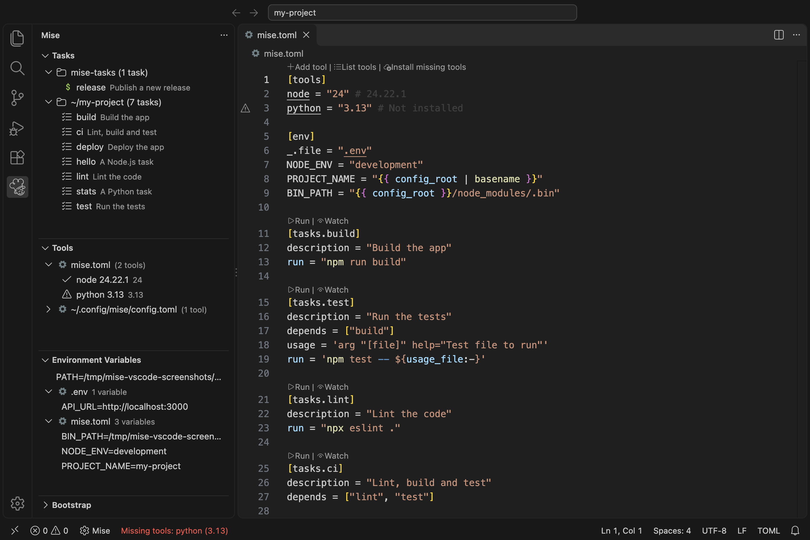
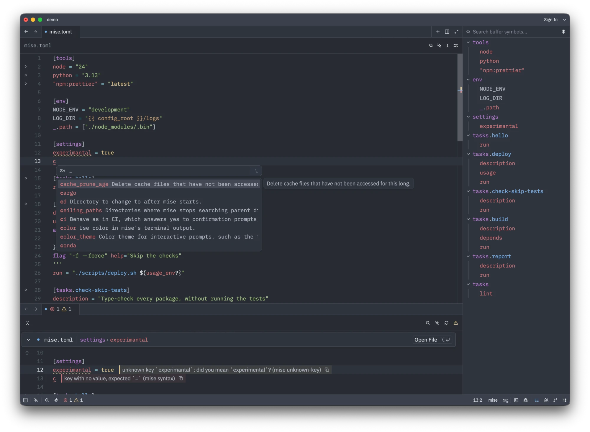

# 编辑器和 IDE

编辑器的集成终端、语言服务器、调试器和扩展可能分别运行在不同环境中。先确认哪个进程需要工具或环境变量，再选择相应的集成方式：

| 需求                                              | 集成方式                               | 效果                                                                                                                     |
| ------------------------------------------------- | -------------------------------------- | ------------------------------------------------------------------------------------------------------------------------- |
| 固定的可执行文件或 SDK 目录                         | `mise which node` 或 `mise where java` | 选择已安装路径；更改版本后需更新 IDE 设置。                                                                                |
| 随当前项目切换的工具                                | [Shims](/dev-tools/shims.html)         | shim 运行时解析工具并加载 mise 环境变量。进程必须在项目目录中运行。                                                         |
| 使用项目环境运行的命令                              | `mise exec -- command`                 | 为该命令及其子进程加载工具和环境变量。                                                                                   |
| 随配置变化而更新的编辑器功能                        | [编辑器插件](#ide-plugins)             | 支持情况取决于编辑器、扩展和语言。                                                                                       |

请先在项目中运行 `mise install`。仅指定 SDK 路径不会加载 `[env]`。Shims 也不会更改已运行编辑器的环境，因此修改继承的环境或固定 SDK 路径后，请重启相关语言服务器或编辑器。

## 指向全局版本的固定路径 {#global-version-link}

IDE 中的 Maven 或 JDK 主目录等设置需要填写安装目录，因此需要一个在版本切换后仍有效的路径。每个工具的安装目录都有一个 `global` 链接，指向由全局配置和系统配置选定的版本：

```sh
~/.local/share/mise/installs/maven/global -> ./3.9.16
```

每当 mise 重建其他运行时符号链接（`latest`、`3`）时，例如运行 `mise use -g` 或 `mise install` 后，它也会更新此链接。项目配置和 `MISE_*_VERSION` 变量不会更改它；未被全局或系统配置选中的工具没有该链接。若 `global` 是实际目录，mise 不会修改它。

## 将 shims 加入 GUI 编辑器的 PATH {#adding-shims-to-path-default-shell}

从桌面启动的编辑器（包括 VS Code 和 JetBrains IDE）会读取登录 shell 的环境。将 mise [shims](/dev-tools/shims.html) 加入登录 shell 的 profile 后，这些编辑器无需提示符钩子也能找到 mise 工具。运行以下命令查看登录 shell：

::: code-group

```sh [macOS]
dscl . -read /Users/$USER UserShell
```

```sh [Linux]
getent passwd $USER | cut -d: -f7
```

:::

接着按照[如何将 mise shims 加入 PATH](/dev-tools/shims.html#how-to-add-mise-shims-to-path)中的说明，将 `mise activate --shims` 加入该 shell 的登录 profile；其中也介绍了 Bash 会读取哪个文件。如果运行 profile 时 `mise` 不在 `PATH` 中，请使用绝对路径，例如 `eval "$($HOME/.local/bin/mise activate zsh --shims)"`。

修改 profile 后请重启编辑器。有些桌面环境只在登录时读取登录 profile，因此你可能需要注销后重新登录。如果编辑器完全不读取 shell profile，请检查它的环境设置。VS Code 的[环境解析](https://code.visualstudio.com/docs/terminal/advanced#_environment-inheritance)和[任务终端 profile](#vscode-automation-profile-for-macos)是两套独立机制。

VS Code 和 IntelliJ 通过 shims 使用 mise 提供的 `node`：

::: tabs
== VS Code


== IntelliJ

:::

Shims 只会为它启动的工具进程设置 `[env]` 变量。编辑器本身及直接读取环境变量的功能无法获取这些变量；这类场景请使用[编辑器插件](#ide-plugins)。

## 编辑器插件 {#ide-plugins}

以下社区插件可以与 mise 集成：

| 编辑器          | 插件                                                                                     | 功能                                                                                                                                |
| -------------- | -------------------------------------------------------------------------------------- | ----------------------------------------------------------------------------------------------------------------------------------- |
| VS Code        | [mise-vscode](https://marketplace.visualstudio.com/items?itemName=hverlin.mise-vscode) | Manages tools and tasks, loads the project environment, helps edit config, and can configure language extensions to use mise tools. |
| JetBrains IDEs | [intellij-mise](https://github.com/134130/intellij-mise)                               | Configures the IDE's SDKs from mise, runs mise tasks, and loads environment variables in run configurations.                        |
| Neovim         | [miser.nvim](https://github.com/carldaws/miser.nvim)                                   | Starts language servers and formatters for the tools in `mise.toml`, and runs mise tasks from Neovim.                               |
| Emacs          | [mise.el](https://github.com/eki3z/mise.el)                                            | Loads the mise environment for each buffer.                                                                                         |
| Zed            | [mise-zed](https://github.com/hverlin/mise-zed)                                        | 为 mise 配置文件运行 `mise lsp`，高亮任务脚本，并运行 mise 任务和工具。                              |

## 语言服务器 {#language-server}

`mise lsp` 会为 mise 配置文件运行 [Language Server Protocol](https://microsoft.github.io/language-server-protocol/) 服务器。它读取 mise 用于验证配置的同一套架构，因此报告内容与当前安装的 mise 版本一致。它处理 `mise.toml`、`.mise.toml`、`mise.<env>.toml`、`mise.local.toml`、`mise/config.toml` 以及 `conf.d` 中的文件，并忽略其他文件。因此，将它关联到 TOML 语言不会影响 `Cargo.toml` 和 `pyproject.toml`。

它提供以下功能：

- **诊断**：TOML 语法错误、带有“是否要找”建议的未知键、类型不正确的值、已弃用的键、没有对应任务定义的任务名称，以及依赖循环。
- **补全**：补全键（包括内联表中的键），以及值范围固定的配置项（例如布尔值和枚举）。表中已有的键不会再次显示。
- **工具**：根据[注册表](/registry.html)补全 `[tools]`（以及任务的 `tools`）下的工具名称；悬停在工具名称上可查看其描述和安装后端。详见[工具](#language-server-tools)。
- **悬停**：查看配置键的说明。
- **快速修复**：将未知键或任务名称替换为建议值，并将已弃用的键改写为替代键。
- **格式化**：与 [`mise fmt`](/cli/fmt.html) 的行为相同。
- **语义标记**：标注 TOML 语法无法判断的键类型，包括任务和模板名称（`function`，以及定义处的 `declaration`，还包括 `depends`、`depends_post`、`wait_for`、`extends` 和 `run = [{ task = "..." }]` 中的名称）、工具（`type`）、环境变量（`variable`）、变量（`variable`、`readonly`）、环境指令中的 `_`（`keyword`）、模板中的 `{{ }}`、`` 和 `{# #}`（`macro`），以及已弃用的键（`deprecated` 修饰符）。标记会针对整个文件或指定范围发送。无法解析的文件不会发送标记，因此客户端会保留已有颜色。
- **任务**：补全 `depends`、`depends_post`、`wait_for` 和 `run = [{ task = "..." }]` 中的任务名称，以及 `extends` 中的模板名称；悬停可查看任务描述和命令；支持转到定义、查找引用，以及在文件中重命名任务和它的所有引用。详见[任务](#language-server-tasks)。

诊断会包含 `code`（`syntax`、`unknown-key`、`deprecated-key`、`invalid-value`、`unknown-task` 或 `task-cycle`）；建议值则位于诊断的 `data` 中。
未知的 `[settings]` 键会作为警告报告，因为 mise 仍会加载该文件；其他未知键会作为错误报告。文件无法解析时，未编辑部分的诊断仍会保留。

### 任务 {#language-server-tasks}

服务器会收集当前文件、其上级目录中的配置、用户和系统配置（包括 `MISE_CONFIG_DIR` 和 `MISE_SYSTEM_CONFIG_DIR`），以及这些配置的 `[task_config] includes` 所指定 TOML 文件中的任务（可以是单个文件或 TOML 文件目录）。它不会读取 glob、`git::` 或 `oci::` 类型的 include。文件任务（脚本）仅用于下文的 `unknown-task` 检查，服务器只知道其名称，不会显示描述。

```toml
[tasks.build]
description = "compile"
run = "cargo build"

[tasks.test]
depends = ["bu"] # completes to "build"; hover on "build" shows the description and command
```

- 在 `depends` 中对名称执行“转到定义”，会跳转到对应的 `[tasks.<name>]`；如果任务定义在其他文件中，也会跳转到该文件。任务可通过名称或 `alias` 别名查找。
- “查找引用”会列出当前文件中提及某任务的位置。
- 重命名会修改 `[tasks.<name>]` 键（包括 `[tasks.<name>.env]` 和点分写法），以及同一文件中的所有引用，同时保留任务名之后的参数（例如 `"build --release"`），包括以环境变量赋值开头的参数（例如 `"PROFILE=release build"`）。服务器不会编辑其他文件，因此如果其他配置或 include 文件也引用了该任务，或者有配置或 include 文件无法读取（例如 glob、远程 include，或文件数量超过读取上限），重命名会被拒绝。此处不能重命名定义在其他文件中的任务或别名。如果重命名会改变文件含义，例如生成服务器无法识别的名称拼写，操作会被拒绝，不会只完成一部分。
- `extends` 引用模板 `[task_templates.<name>]`，因此也支持在模板中补全、跳转和重命名。

### 工具 {#language-server-tools}

在 `[tools]` 下，键补全会显示注册表中的短名称，与 `mise registry` 输出相同，并附带每个工具的描述。悬停在工具名称上可查看描述和安装后端。注册表声明的别名（例如 `ripgrep` 的 `rg`）也会识别；mise 通过其他方式解析的名称（例如 `nodejs`、`golang`）则不会识别。与 `mise registry` 一样，已弃用的工具以及被 `enable_tools` 和 `disable_tools` 筛除的工具不会出现在补全列表中。

<!-- schema: skip -->

```toml
[tools]
no # completes to node; hover on `node` shows "Node.js runtime" and `core:node`
```

列表来自 `mise lsp` 启动时读取的注册表，该注册表内置于 mise 中（启用 `registry_floating` 时则使用缓存的浮动注册表）。服务器不会查询任何内容：它不会列出或解析版本，也不会访问网络。工具补全和悬停分别受 `completion` 和 `hover` 开关控制。带有后端前缀的工具（例如 `"npm:prettier"`）不在注册表中，因此只能显示架构提供的悬停说明。

服务器会像 [`mise tasks validate`](/cli/tasks/validate.html) 一样检查任务引用，并提供两种诊断：

- `unknown-task`（警告）会标出 `depends`、`depends_post`、`wait_for` 或 `run = [{ task = "..." }]` 中没有对应任务定义的名称，也会标出 `extends` 中没有 `[task_templates]` 定义的模板，并提供“是否要找”修复建议。它会跳过模式（`lint:*`）、monorepo 引用（`//app:build`、`:build`）和 `{ task = "x", optional = true }`。文件任务（`mise-tasks/` 及其他任务目录中的脚本，以及 `includes` 指定目录中的可执行文件）会被视为已定义；匹配时会检查带或不带扩展名的路径，以及文件头中的 `#MISE alias=` 行。扫描 include 目录时会忽略其下的 `node_modules` 和 `target`；如果因此无法可靠检查，`unknown-task` 会停用。带有 `*`、`?`、`[` 或 `{` 的模式也会跳过。当前文件上级目录中的配置以及用户和系统配置（包括 `MISE_CONFIG_DIR` 和 `MISE_SYSTEM_CONFIG_DIR`）也参与检查。只有服务器启动时 `MISE_ENV` 中指定环境对应的 `mise.<env>.toml` 才会读取；其他环境中的任务名称会被视为未知，从而停用 `unknown-task`。如果任务可能来自服务器不会读取的位置，例如 `includes` 中的 glob、`git::` 或 `oci::` 条目、`task_config.dir`，或服务器扫描条目数超限的目录（总计约 5000 项），服务器不会报告诊断，以免猜测。
- `task-cycle`（错误）会标出当前文件定义的任务中，属于依赖循环的每个 `depends`，并在消息中显示循环路径。mise 会忽略任务对自身的依赖，因此不会报告这种情况。

`[task_config] includes` 列出的是任务文件而非配置文件，因此即使文件名是 `mise.tasks.toml`，服务器也不会处理它。

只有当架构说明将替代项明确写为一个键时，已弃用的键才会提供快速修复（例如，说明只写 `deprecated alias for run in hooks` 时并未指定替代键）。应用修复时还会再次确认改写安全：替代键必须由架构声明、值必须符合其架构、目标键必须尚未设置，并且文件解析后的文档不能改变。比如 `env_path = ["bin"]` 会改为 `env._.path = ["bin"]`，`[settings] task_output = "prefix"` 会改为 `task.output = "prefix"`。其他情况需要手动改写。

服务器只解析配置，不会渲染模板或运行任何内容，因此打开不受信任的文件也是安全的。

配置编辑器，让它针对 mise 配置文件启动 `mise lsp`。Neovim 配置示例如下：

```lua
vim.lsp.config("mise", {
  cmd = { "mise", "lsp" },
  filetypes = { "toml" },
  root_markers = { "mise.toml", ".mise.toml" },
})
vim.lsp.enable("mise")
```

在 Zed 中，[mise-zed](#zed) 扩展会启动该服务器。Helix、Emacs 等带有通用 LSP 客户端的编辑器也使用相同命令。详见 [`mise lsp`](/cli/lsp.html) 参考。

如果 Tombi 或 Even Better TOML 等其他 TOML 服务器也处理同一批文件，悬停、补全和格式化功能会重复显示。客户端可以通过 `initializationOptions` 关闭这些功能，只保留 mise 提供的能力：

```json
{ "formatting": false, "hover": false, "completion": false }
```

同样可以通过 `definition`、`references` 和 `rename` 关闭任务导航功能。`completion` 和 `hover` 中的任务名称及描述也会遵循相应开关。只有启用的能力才会向客户端声明。

不支持 `mise lsp` 的旧版 mise 会在项目中存在名为 `lsp` 的任务时运行该任务，此时 `mise lsp --help` 会显示该任务的帮助。若要检查命令是否存在，请查看 `mise help lsp` 输出中是否包含 `Usage: mise lsp`；旧版本会显示 mise 自身的帮助。

## VS Code {#vscode}

[`mise-vscode` 扩展](https://hverlin.github.io/mise-vscode/)可以配置[受支持的语言扩展](https://hverlin.github.io/mise-vscode/reference/supported-extensions/)以使用 mise 工具。该功能默认关闭；启用 [`mise.configureExtensionsAutomatically`](https://hverlin.github.io/mise-vscode/reference/settings/#miseconfigureextensionsautomatically) 即可开启。环境和任务设置请参阅扩展文档。



Install mise on the machine that runs the extension. A local installation does
not provide tools inside an SSH host, a WSL distribution or a
[dev container](#dev-containers).

### 任务和调试终端 {#vscode-automation-profile-for-macos}

VS Code 会在自动化终端中运行任务和调试会话。若要让它启动会读取 profile 的登录 shell，并一并加载 shims，请在 `settings.json` 中添加[自动化 profile](https://code.visualstudio.com/docs/terminal/profiles#_configuring-the-taskdebug-profile)：

::: code-group

```json [macOS]
{
  "terminal.integrated.automationProfile.osx": {
    "path": "/bin/zsh",
    "args": ["--login"]
  }
}
```

```json [Linux]
{
  "terminal.integrated.automationProfile.linux": {
    "path": "/bin/bash",
    "args": ["--login"]
  }
}
```

:::

自动化 profile 不会配置扩展宿主或所有语言服务器。请将 shims 保留在登录 profile 中；加入 `--interactive` 还会加载交互式启动文件及提示符定制，而构建任务通常不需要这些内容。

### 在 launch.json 中通过 mise exec 调试 {#use-mise-exec-in-launch-configuration}

如需使用项目工具调试 Node.js，可在 `launch.json` 中通过 [`mise exec`](/cli/exec.html) 启动运行时。将 `cwd` 设置为包含 `mise.toml` 的目录。如果编辑器找不到 `mise`，请将 `runtimeExecutable` 设为其绝对路径。以下示例适用于 macOS 和 Linux：

```json
{
  "version": "0.2.0",
  "configurations": [
    {
      "type": "node",
      "request": "launch",
      "name": "启动程序",
      "program": "${file}",
      "cwd": "${workspaceFolder}",
      "runtimeExecutable": "mise",
      "runtimeArgs": ["exec", "--", "node"]
    }
  ]
}
```

## JetBrains IDE {#jetbrains-editors-intellij-rustrover-pycharm-webstorm-rubymine-goland-etc}

以下说明适用于 IntelliJ IDEA、PyCharm、WebStorm、GoLand、RubyMine、RustRover 等 JetBrains IDE。[intellij-mise 插件](https://github.com/134130/intellij-mise)可以自动根据 mise 配置 SDK。

### 直接选择 SDK

IntelliJ IDEA 的 Java SDK 选择器可以检测 mise 安装的 JDK：


### 使用 asdf 目录布局选择 SDK

有些语言插件无法找到 mise 安装的 SDK，但可以识别 asdf 的目录结构。若可以直接选择 SDK，请优先使用该方式。如果插件需要 asdf 目录且 `~/.asdf` 不存在，可以通过符号链接公开 mise 的目录布局。不要替换现有的 asdf 安装，也不要使用 asdf 修改由 mise 管理的安装：

```sh
ln -s ~/.local/share/mise ~/.asdf
```

之后即可在 Project Settings 中看到这些 SDK：


对于 Node.js 和其他一些语言，该设置位于“Languages & Frameworks”下：


## Neovim {#neovim}

以下 Vim、Neovim 和 Emacs 代码片段使用默认数据目录。如果设置了 `MISE_DATA_DIR`，请改用 `$MISE_DATA_DIR/shims`。

```lua
-- 将 mise shims 加到 PATH 前面
vim.env.PATH = vim.env.HOME .. "/.local/share/mise/shims:" .. vim.env.PATH
```

Treesitter 和语言服务器的设置方式参见 [Neovim 指南](/mise-cookbook/neovim.html)，也可以使用 [miser.nvim](https://github.com/carldaws/miser.nvim)。

## Vim {#vim}

```vim
" 将 mise shims 加到 PATH 前面
let $PATH = $HOME . '/.local/share/mise/shims:' . $PATH
```

## Emacs {#emacs}

如需使用 shims：

```lisp
(let ((mise-shims (expand-file-name "~/.local/share/mise/shims")))
  (setenv "PATH" (concat mise-shims (char-to-string path-separator) (getenv "PATH")))
  (add-to-list 'exec-path mise-shims))
```

如果希望为每个缓冲区加载 mise 环境，请按照 README 安装 [mise.el](https://github.com/eki3z/mise.el)，然后启用它：

```lisp
(require 'mise)
(add-hook 'after-init-hook #'global-mise-mode)
```

## Zed {#zed}

[`mise-zed` 扩展](https://github.com/hverlin/mise-zed)会为 mise 配置文件运行 [`mise lsp`](#language-server)，根据任务脚本的语言进行高亮，并为任务和工具添加运行按钮。Zed 会为项目加载 Shell 环境，因此 `mise activate` 加入 `PATH` 的工具无需 shims 即可找到。

::: tip
`mise lsp` 需要 mise 2026.10.18 或更高版本。语义标记需要 mise 2026.10.19 或更高版本。
:::



只有在 Zed 设置中为该语言启用后，Zed 才会请求 `mise lsp` 的[语义标记](#language-server)：

```json
{ "languages": { "mise": { "semantic_tokens": "combined" } } }
```

## Xcode {#xcode}

Xcode 构建阶段不会运行交互式 shell 启动文件。请使用 mise 的绝对路径，并明确指定项目目录。对于声明了 SwiftLint 的项目：

```sh
"$HOME/.local/bin/mise" --cd "$SRCROOT" exec -- swiftlint lint
```

构建前请先安装项目工具。如果 mise 是由包管理器安装的，请相应调整其路径。

启用 User Script Sandboxing 后，请在构建阶段声明脚本的输入和输出。`$(SRCROOT)/mise.toml` 是一个输入，但 mise 和工具也可能读取其他配置文件、已安装的可执行文件及数据目录，因此仅允许访问 `mise.toml` 对某些工具并不足够。请根据构建日志中的沙盒拒绝记录查找缺失项。Xcode Cloud 的设置方式参见[持续集成](/continuous-integration.html#xcode-cloud)。

## 开发容器 {#dev-containers}

[`mise generate devcontainer`](/cli/generate/devcontainer.html) 会创建初始配置 `.devcontainer/devcontainer.json`，其中包含 mise 开发容器功能和 mise-vscode 扩展：

```sh
mise generate devcontainer --write
```

该文件会将 `postCreateCommand` 设为 `mise install`，以便新容器安装项目工具。`--mount-mise-data` 会为 mise 数据目录添加命名卷，使已安装工具在容器重建后仍可保留。构建前请检查镜像和挂载设置。如需在 home 目录从主机挂载的镜像中预装工具，请参阅 [Docker 指南](/mise-cookbook/docker.html#devcontainers-with-home-directory-mounts)。

## Windows {#windows}

按照 [Windows shell](/shell-setup.html#windows) 一节所述，将 `%LOCALAPPDATA%\mise\shims` 加入用户 `Path`，让编辑器找到 mise 工具，然后重启编辑器。如果扩展报告 `spawn EINVAL`，请参阅[故障排查指南](/troubleshooting.html#vscode-for-windows-extension-with-error-spawn-einval)。

## AI 编程助手 {#ai-coding-assistants}

在终端中运行命令的助手与其他进程一样，通过激活、shims 或 `mise exec` 获取 mise 工具。如需让助手读取项目工具、任务和环境并运行任务，请将它连接到 [mise MCP 服务器](/mcp.html)。通过 packslip 安装的工具也可以提供 agent skill；详见[手册页、补全和技能](/dev-tools/packslip-resources.html)。

## 诊断编辑器不匹配问题

在项目目录中运行以下命令，将 mise 选中的可执行文件与编辑器实际使用的文件进行比较：

```sh
mise which node
mise exec -- node --version
```

请在语言服务器或调试器日志中查看其可执行文件路径和工作目录。如果以上命令正常，但编辑器选择了其他版本，请修正该进程的 SDK 设置、`PATH` 或工作目录。集成终端运行正常，并不能证明语言扩展使用了相同的环境。
