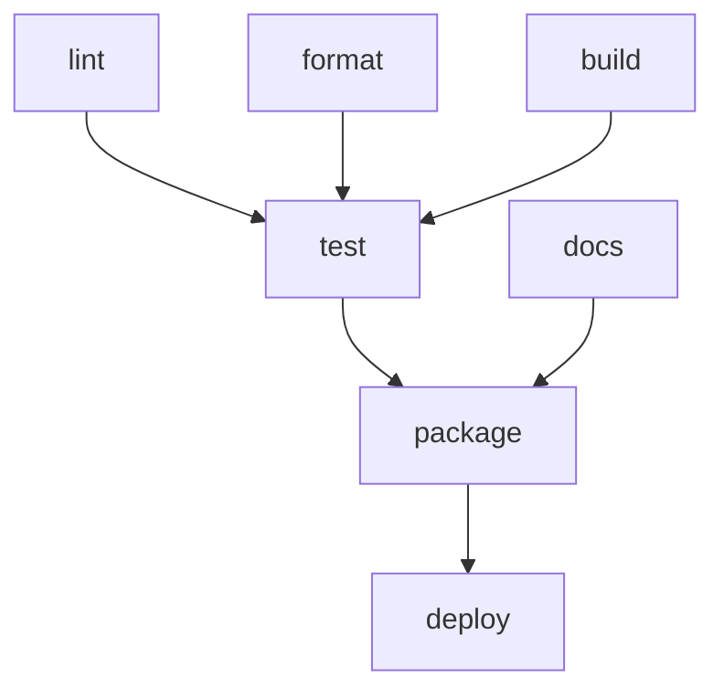

# 依赖关系与执行顺序

运行任务时，mise 会为该任务及其所有依赖项构建依赖图，并在前置任务成功后立即启动任务，直到达到并行作业数上限。本页介绍如何选择依赖类型，以及如何排查执行顺序问题。

## mise 如何调度任务

运行 `mise run deploy` 时，mise 会从所有生效的配置中加载任务，按名称或别名查找 `deploy`（或展开[通配符模式](/tasks/running-tasks.html#wildcards)），将其依赖项加入依赖图，检查并拒绝循环依赖，然后在各任务的前置条件满足后启动任务。在此依赖图中，箭头从前置任务指向依赖它的任务：



`lint`、`format`、`build` 和 `docs` 会同时启动。它们成功后，`test` 才会启动；`test` 和 `docs` 完成后，`package` 才会启动。调度规则如下：

- 所有前置任务成功后，任务才会启动。
- 依赖图中互不依赖的任务会并行运行，最多达到 `--jobs` 指定的数量（即[`jobs`](/configuration/settings.html#jobs)设置）。
- 多个任务共同依赖的任务只会运行一次。
- 如果依赖图中存在循环，mise 会在任何任务运行前拒绝执行。
- 任务失败会停止本次运行，其依赖任务不会启动；传入 `--continue-on-error` 时除外。详见[任务失败时的处理](/tasks/running-tasks.html#when-a-task-fails)。

mise 会按完整名称、别名或通配符匹配任务；不带扩展名时也会匹配对应文件任务，因此 `mise run build` 可以找到 `build.sh`。mise 不支持部分名称匹配：即使存在 `build`，`mise run bui` 仍会因 `no task bui found` 而失败。

[任务发现和优先级](/tasks/task-discovery.html)介绍 mise 从哪里查找任务，以及两个配置定义同名任务时[哪项定义生效](/tasks/task-discovery.html#which-definition-wins)。

## 选择依赖类型

| 机制                                      | 是否将任务加入运行 | 执行时机                                                              | 在 `mise tasks deps` 中显示 |
| ----------------------------------------- | ------------------------ | --------------------------------------------------------------------- | --------------------------- |
| [`depends`](#depends)                     | Yes                      | Before this task; this task does not start if it fails                | Yes                         |
| [`wait_for`](#wait-for)                   | No                       | Before this task, only when the other task is already in the run      | Only when both are selected |
| [`depends_post`](#depends-post)           | Yes                      | After this task, even if this task fails                              | As `<name> (post)`          |
| `run` 中的[运行步骤](#run-steps-in-order) | 是，作为一个步骤   | 按 `run` 顺序执行；`{ tasks = [...] }` 步骤中的任务会并行运行           | 否                          |

`depends`、`wait_for` 和 `depends_post` 接受任务名称、别名和模式；每个条目还可以向指定任务传递参数和环境变量。完整语法请参阅任务配置参考中的[`depends`](/tasks/task-configuration.html#depends)。

### `depends`

此任务运行前必须成功完成的前置任务：

```mise-toml [mise.toml]
[tasks.test]
depends = ["lint", "build"]
run = "npm test"
```

`lint` 和 `build` 会并行运行，列表中的先后顺序不影响执行。

在[单体仓库](/tasks/monorepo.html#task-path-syntax)中，可通过任务路径依赖另一个项目的任务，例如 `depends = ["//api:build"]`。

### `depends_post` {#depends-post}

无论此任务成功还是失败，都会在其结束后运行的任务：

```mise-toml [mise.toml]
[tasks.deploy]
depends = ["build", "test"]
depends_post = ["cleanup", "notify"]
run = "kubectl apply -f deployment.yaml"
```

`deploy` 结束后会运行 `cleanup`、`notify` 及它们自身的依赖项，即使 `deploy` 失败也一样。`deploy` 的自身依赖项失败时的处理方式，请参阅[`depends_post`](/tasks/task-configuration.html#depends-post)。

### `wait_for` {#wait-for}

只有当其他操作已将这些任务加入本次运行时，才要求它们先完成。`wait_for` 本身不会将这些任务加入运行：

```mise-toml [mise.toml]
[tasks.integration-test]
wait_for = ["start-services"]
run = "npm run test:integration"
```

`mise run integration-test` 只运行 `integration-test`。`mise run start-services ::: integration-test` 会先运行 `start-services`。如果名称没有匹配到任务，仍会报错；除非条目设置了 `optional = true`。详见[`wait_for`](/tasks/task-configuration.html#wait-for)。

### 按顺序运行步骤 {#run-steps-in-order}

`run` 数组可以将其他任务作为步骤调用。每个步骤完成后才会启动下一步；`{ tasks = [...] }` 步骤中的任务则会并行运行：

```mise-toml [mise.toml]
[tasks.example1]
run = "echo example1"

[tasks.example2]
run = "echo example2"

[tasks.example3]
run = "echo example3"

[tasks.one_by_one]
run = [
  { task = "example1" },                # finishes before the next step starts
  { tasks = ["example2", "example3"] }, # these two run in parallel
]
```

需要控制顺序时请使用运行步骤。`depends = ["example1", "example2", "example3"]` 也会先运行这三个任务，但它们会并行执行，彼此之间没有先后顺序。

运行步骤属于任务本身，而不属于依赖图，因此 `mise tasks deps one_by_one` 会显示 `one_by_one` 没有依赖项。每个步骤中的任务仍会运行自己的 `depends`。步骤可以传递参数和环境变量，例如 `{ task = "build", args = ["--release"] }`；详见[`run`](/tasks/task-configuration.html#run)。

## 在脚本中运行任务

脚本也可以自行调用 `mise run`，例如只在文件缺失时运行某个任务：

```bash [mise-tasks/start]
#!/usr/bin/env bash
#MISE depends=["setup"]
if [ ! -f .env ]; then
  mise run generate-env
fi
npm start
```

嵌套调用的 `mise run` 会启动一次独立运行，不会加入当前依赖图，也不会出现在 `mise tasks deps` 中。若要根据 `--with-lint` 等标志选择行为，请使用[用法规范](/tasks/task-arguments.html)定义该标志，而不是读取 `$1`。

## 检查和调试

### 查看依赖图

```sh
mise tasks deps deploy             # tree of deploy's dependencies
mise tasks deps --dot > deps.dot   # every task, in Graphviz format
mise run --dry-run deploy          # each command, in execution order, without running it
```

[`mise tasks deps`](/cli/tasks/deps.html) 会显示 `depends`、`depends_post` 和 `wait_for` 关系，但不显示运行步骤。只有两个任务都被选中时，才会显示 `wait_for` 关系。后置依赖项会显示为 `<name> (post)`，单个任务的依赖树中也一样。

### 任务运行或跳过的原因

任务设置了 `sources` 和 `outputs` 后，只要输出文件仍是最新状态，就会被跳过。详见[跳过已是最新状态的任务](/tasks/running-tasks.html#skip-tasks-that-are-up-to-date)和[任务缓存](/tasks/caching.html)。`mise run --force` 会强制运行任务；`mise run --verbose` 会打印调试日志，包括 mise 启动的每条命令。

### `circular dependency detected`

```text
mise ERROR circular dependency detected: test -> build -> test
```

冒号后的路径表示循环依赖。请移除其中一条依赖边，或将共享工作移到两个任务都依赖的独立任务中。如果两个任务都在本次运行中，`wait_for` 也会对它们排序，因此不能用它打破循环依赖。

### `task not found`

```text
mise ERROR task not found: lint
```

`depends`、`depends_post` 或 `wait_for` 条目指定了不存在的任务。请定义该任务、修正名称，或将条目标记为 `{ task = "lint", optional = true }`。命令行中输入的名称没有匹配到任何任务时，会报错 `no task <name> found` 并列出可用任务。

### 任务逐个运行

如果原本预期并行的任务形成了一条依赖链，请运行 `mise tasks deps <task>` 查找原因。检查 `--jobs` 值和 `MISE_JOBS`，并确认任务是否设置了[`raw`](/tasks/task-configuration.html#raw)或[`interactive`](/tasks/task-configuration.html#interactive)；这两种模式会独占终端访问权限。`mise run --raw` 和全局[`raw`](/configuration/settings.html#raw)设置也会让命令逐个运行。
