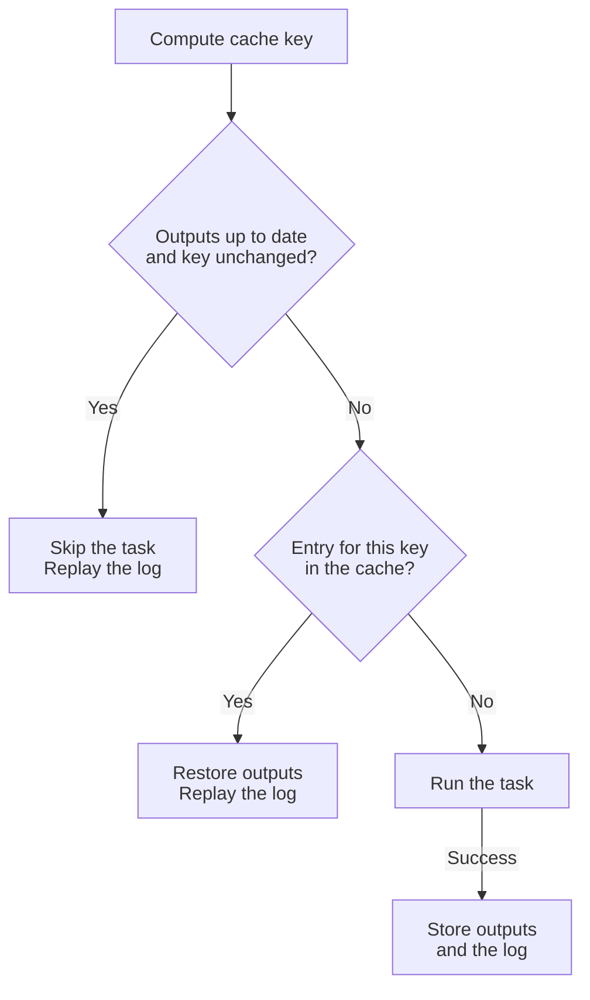

# 任务缓存

当任务输入未变化时，mise 可以通过两种方式跳过任务。新鲜度检查比较文件修改时间，只需要配置 `sources` 和 `outputs`。制品缓存还可以恢复已删除的输出，以及较早输入对应的结果，例如切回此前已经构建过的分支时。

| 机制             | 比较内容                                       | 输入未变化时的行为                            | 状态         |
| ---------------- | ---------------------------------------------- | --------------------------------------------- | ------------ |
| 新鲜度检查       | 来源文件和输出文件的修改时间                   | 跳过任务并保留其输出                          | 稳定         |
| 制品缓存         | 来源内容及其他缓存键输入                       | 恢复输出并重放任务日志                        | 实验性       |

若要在 CI 与开发机器之间共享制品缓存结果，请参阅[远程任务缓存](/tasks/remote-cache.html)。

## 跳过最新任务

为任务配置 `sources` 和 `outputs`：

```mise-toml
[tasks.build]
run = "cargo build"
sources = ["Cargo.toml", "src/**/*.rs"]
outputs = ["target/debug/mycli"]
```

首次运行 [`mise run build`](/cli/run.html) 时会执行 `cargo build`。之后只要任务未变为[过期](#what-makes-a-task-stale)，就会输出 `[build] sources up-to-date, skipping`。使用 `mise run --force build` 可强制运行；`--force` 也会重新运行任务依赖项。

[`sources`](/tasks/task-configuration.html#sources) 和 [`outputs`](/tasks/task-configuration.html#outputs) 接受 glob、`!` 排除项和 usage 参数；模式语法见任务配置参考。 [`mise watch`](/cli/watch.html) 使用相同的 `sources` 来决定监视哪些文件。

### 任务何时过期

配置了 `sources` 的任务只有在满足以下所有条件时才算最新：

- 每个已声明的输出都存在。
- 最新来源文件的时间早于最新输出文件。
- 来源文件列表，以及每个文件的大小和修改时间，都与 mise 在任务上次成功后记录的值一致。因此，删除来源、添加来源或恢复旧副本都会使任务过期。
- 来源文件的修改时间都不是零（1970-01-01）；部分归档工具会将修改时间设为零。
- 同一次 `mise run` 中，没有运行或从缓存恢复任何自身配置了 `sources` 的依赖项。

mise 会将定义任务的配置文件加入来源。编辑该文件（即使只是修改另一个任务）也会使此任务过期。

失败的运行不会记录任何内容，因此任务会一直过期，直到运行成功。

### 输出

- `outputs = ["dist"]` 这样的显式路径或 glob 会按照[新鲜度规则](#what-makes-a-task-stale)进行比较。
- 任务配置了 `sources` 但未配置 `outputs` 时，mise 会使用 `outputs = { auto = true }`。每次成功运行后，它会在状态目录中更新一个标记文件；此后只要来源发生变化，任务就会重新运行。
- `outputs = []` 表示任务不会写入文件，因此新鲜度检查永远不会跳过它。启用[制品缓存](#enable-artifact-caching)后，mise 会改为缓存任务结果和日志。

### 依赖项

配置了 `sources` 的依赖项运行或从制品缓存恢复输出时（包括因 `--force` 而运行），所有依赖它的任务也会运行，即使这些任务自己的来源没有变化：

```mise-toml
[tasks."core:build"]
run = "tsc -p packages/core"
sources = ["packages/core/src/**/*.ts"]
outputs = ["packages/core/dist/**/*.js"]

[tasks."frontend:build"]
run = "tsc -p packages/frontend"
sources = ["packages/frontend/src/**/*.ts"]
outputs = ["packages/frontend/dist/**/*.js"]
depends = ["core:build"]
```

更改 `packages/core/src/` 会运行这两个任务。没有更改时，两个任务都会被跳过。未配置 `sources` 的依赖项每次都会运行，因此不会使依赖它的任务失效。

### 所有任务共用的输入

[`task_config.global_inputs`](/tasks/task-configuration.html#task_config.global_inputs)
<Badge type="warning" text="实验性" /> 会将来源模式添加到配置范围内的每个任务，例如添加会使所有任务失效的锁文件。未自行配置 `sources` 的任务也会继承这些输入和自动输出，因此只要它们未变化，mise 就会跳过任务。

### 新鲜度设置

- [`task.source_freshness_hash_contents`](/configuration/settings.html#task.source_freshness_hash_contents) 会将来源内容的 BLAKE3 哈希与任务上次成功后记录的值比较，并忽略修改时间。如果输出自上次运行后发生变化，任务也会过期。启用该设置后的第一次运行始终会执行任务。
- [`task.source_freshness_equal_mtime_is_fresh`](/configuration/settings.html#task.source_freshness_equal_mtime_is_fresh) 会将修改时间相同的来源和输出视为最新。时间戳精度较低的文件系统可启用此设置。

## 启用制品缓存 <Badge type="warning" text="实验性" /> {#enable-artifact-caching}

::: warning 实验性功能
使用制品缓存需要设置 `experimental = true`。
:::

对同时配置了 `sources` 和 `outputs` 的任务设置 `cache = { enabled = true }`。任务成功运行后，mise 会根据任务输入计算缓存键，并保存输出和任务日志。相同输入再次出现时，mise 会恢复缓存，而不运行任务。

```mise-toml
[settings]
experimental = true

[tasks.build]
run = "npm run build"
sources = ["package.json", "src/**"]
outputs = ["dist"]
cache = { enabled = true, env = ["NODE_ENV"] }
```

| 情况                                           | mise 输出                                      | 行为                                                         |
| ---------------------------------------------- | --------------------------------------------- | ------------------------------------------------------------ |
| 首次运行                                       | `[build] cache miss: no matching cache entry` | 运行 `npm run build` 并保存 `dist` 和日志                    |
| 再次运行，输入未变化                           | `[build] sources up-to-date, skipping`        | 跳过任务并重放已保存的日志                                   |
| `dist` 已删除                                  | `[build] restored outputs from cache 7ede…`   | 恢复 `dist` 并重放日志，不运行任务                           |
| `src` 更改并构建后又恢复原状                  | `[build] restored outputs from cache 7ede…`   | 找到先前输入对应的条目并恢复                                 |
| `NODE_ENV=production`，此前未见过该值          | `[build] cache miss: no matching cache entry` | 运行任务，并为新值保存第二个条目                             |

对于 lint 或测试等不写入文件的检查，可设置 `outputs = []`，只缓存结果和日志。输入未变化时再次运行会输出 `sources up-to-date, skipping` 并重放日志。恢复较早输入对应的结果时（例如撤销某项更改后），会输出 `restored result from cache <key>`：

```mise-toml
[tasks.lint]
run = "eslint ."
sources = ["package.json", "src/**"]
outputs = []
cache = { enabled = true }
```

### 要求

- [`experimental`](/configuration/settings.html#experimental) 为 `true`。
- 任务至少配置一项 `sources`。
- 任务显式配置了 `outputs` 或 `outputs = []`。自动输出不能被存储。
- 每个输出模式（包括 `!` 排除项之后的部分）都必须是任务目录内的相对路径，且任何输出都不能包含来源。

任务设置 `cache.enabled = true` 却不满足这些要求时会失败，例如报错 `task build cache requires at least one source`。

### mise 不使用缓存的情况

- `mise run --task-cache off` 或 `MISE_TASK_CACHE=off` 会在本次运行中关闭制品缓存，但新鲜度检查仍会生效。
- `mise run --dry-run` 不会读取、写入或计算缓存键，除非同时请求[缓存键说明](#inspect-and-diagnose-cached-results)。
- `mise run --force` 会跳过缓存读取并运行任务，然后保存新结果。
- 接收 [`secrets`](/tasks/task-configuration.html#secrets) 的任务永远不会缓存，因为日志或输出可能包含密钥。mise 会发出警告，但新鲜度检查仍适用。
- `raw` 或 `interactive` 任务，以及任何使用 `--raw` 运行的任务都会占用终端，因此不会缓存。mise 会发出警告，且每次都会运行任务。
- 同一次 `mise run` 中，如果依赖项配置了 `sources` 但未启用制品缓存，任务会运行而不会恢复缓存。

### 为项目中所有符合条件的任务启用缓存

设置 `task_config.cache` 可为配置范围内的所有任务提供默认 `cache` 值。只有至少配置一个来源，且显式设置输出或 `outputs = []` 的任务会采用该值；其他任务仍不缓存。任务自身的 `cache` 值会完全替代默认值。

```mise-toml
[settings]
experimental = true

[task_config.cache]
enabled = true
env = ["NODE_ENV"]
command_inputs = ["node --version"]

[tasks.build]
run = "npm run build"
sources = ["package.json", "src/**"]
outputs = ["dist"]

[tasks.deploy]
run = "./deploy.sh"
cache = { enabled = false }
```

在 monorepo 中，[`[monorepo.task_defaults]`](/tasks/workspace-graph.html#root-task-defaults) 可为每个项目中的指定任务名称设置 `cache`；Node.js workspace provider 也会从 [`turbo.json`](/tasks/workspace-graph.html#provider-task-suggestions) 读取 `cache`。

## 缓存运行流程 {#artifact-cache-flow}



mise 会先计算缓存键，因此即使之后跳过任务，`cache.command_inputs` 中的命令仍会运行。只有[新鲜度检查](#what-makes-a-task-stale)通过，且缓存键与上次运行时保存的键一致，任务才会跳过；对于 `outputs = []`，则只由缓存键决定。
查找时会先检查本地缓存；如果配置了[远程缓存](/tasks/remote-cache.html)，随后也会检查远程缓存。失败的运行不会被存储。

任务实际运行而非从缓存恢复时，mise 会在 `cache miss:` 后显示原因：

- `no matching cache entry`
- `cache entry was corrupt`
- `cache entry exceeded its age limit`
- `forced execution`
- `cache reads are disabled`
- `dependency completed without a cache key`

## 缓存键包含哪些内容

- 来源文件的路径和内容，以及定义该任务的配置文件。路径相对于最外层配置根目录，因此位于不同位置的检出目录也能共用缓存条目。
- 任务定义：任务名称、`run` 项、参数、shell、输出模式、目录，以及它是否作为 `depends_post` 依赖运行。
- 任务自身 `env` 项的值。
- `cache.env` 和 `task_config.global_env` 中指定的变量值，或变量未设置这一状态。
- 任务可见的 mise 变量，包括 `[vars]` 和任务的 `vars`。
- 每条 `cache.command_inputs` 命令的输出。
- 解析后的工具版本。
- 已缓存依赖项的缓存键。
- 操作系统和体系结构。

从 shell 继承或在 `[env]` 中设置的其他环境变量，只有列入 `cache.env` 后才会成为缓存键的一部分。位于最外层配置根目录之外的来源（例如 `../../shared/file`）会使用绝对路径作为键的一部分，因此只有路径相同的检出目录才能共用该条目。

## 外部依赖与锁文件

将依赖清单和锁文件声明为来源，这样依赖项更新时缓存就会失效。可以将它们列入任务的 `sources`，通过输入组共享，或者用 `task_config.global_inputs` 将它们应用于配置范围内的所有任务：

```mise-toml
[settings]
experimental = true

[task_config]
global_inputs = ["@group:node-dependencies"]

[task_config.input_groups]
node-dependencies = ["package.json", "pnpm-lock.yaml"]

[tasks.build]
run = "pnpm build"
sources = ["src/**"]
outputs = ["dist"]
cache = { enabled = true }
```

锁文件描述了已解析的依赖关系图，因此不要将 `node_modules` 之类的已安装依赖目录列入来源。已解析的 mise 工具已包含在缓存键中。

### 命令输入

对于已提交文件无法反映的外部状态（例如软件包注册表选择或编译器包装器版本），可使用 `cache.command_inputs`：

```mise-toml
[tasks.build]
run = "pnpm build"
sources = ["package.json", "pnpm-lock.yaml", "src/**"]
outputs = ["dist"]
cache = { enabled = true, command_inputs = ["pnpm config get registry"] }
```

每条命令都会在查找缓存前运行，并使用任务的 shell（包括命令行上的 `--shell` 覆盖项）、环境、工具、工作目录和沙箱。命令文本、标准输出和标准错误都会成为缓存键的一部分；mise 会对输出进行哈希处理，但不会打印或保留输出内容。

命令输入不能为空，且必须成功退出。它会继承任务的 `timeout`；如果任务未设置超时时间，则默认使用 30 秒。标准输出与标准错误合计最多可输出 16 MiB。由于 mise 每次计算缓存键时都会运行这些命令，因此命令输入应快速、确定且无副作用。试运行期间，以及 `raw` 和 `interactive` 任务中不会运行这些命令；但请求使用 `--task-cache-explain` 或 `--task-cache-explain-json` 说明缓存键时除外。

### 环境变量与缓存键

`task_config.global_env` 会将变量名加入配置范围内每个启用了缓存的任务的 `cache.env`，包括自行设置 `cache` 的任务：

```mise-toml
[task_config]
global_env = ["CI", "NODE_ENV"]
```

对于不应影响缓存键的凭据和其他值，可在任务上使用 [`pass_through_env`](/tasks/task-configuration.html#sandbox)，或使用 `task_config.global_pass_through_env` 将其应用于范围内的所有任务：

```mise-toml
[task_config]
global_pass_through_env = ["CI_JOB_TOKEN"]

[tasks.build]
pass_through_env = ["NPM_TOKEN"]
```

通过 `allow_env`、`deny_env`、`deny_all` 或对应的命令行选项启用环境沙箱后，这些列表才会影响任务行为。未启用沙箱时，任务仍会继承整个环境。在沙箱中，启用了缓存的任务仍会收到 `cache.env` 和 `task_config.global_env` 指定的变量；未启用缓存的任务则不会收到这些变量。

透传变量可能在不改变缓存键的情况下改变任务行为，因此不要将会影响输出的值设为透传变量。mise 不会存储透传变量的值，但任务仍可能将其写入日志或输出文件。

## 缓存正确性与确定性任务

启用 `cache` 就意味着相同的缓存键输入始终会产生相同的日志和输出。所有可能改变结果的值都必须纳入缓存键：来源或输入组、已解析的 mise 工具、`cache.env`、`cache.command_inputs`，或已缓存的依赖项。其中包括配置和锁文件、区域设置与功能开关、编译器包装器、生成的输入，以及任务读取的外部服务状态。操作系统和体系结构会自动加入；机器的其他信息不会加入。

启用缓存的任务不得依赖未声明的文件、时钟、随机数、不断变化的网络响应或环境中的其他变量。如果无法可靠地捕获这类输入，就不要缓存该任务。若任务只使用凭据来下载内容，缓存键应包含锁文件或该内容的摘要，而不应包含凭据。

声明的输出必须涵盖缓存命中时需要还原的所有内容。mise 不会重放输出以外的副作用，例如数据库写入、部署、通知或工作区其他位置的变更。只有当任务不会修改后续工作所依赖的任何文件时，`outputs = []` 才是正确的设置。

如果不确定，可先使用 `--task-cache off` 运行任务进行排查，补齐缺失的输入，并在信任新缓存条目前使用一次 `--force`。在 Linux 上，[审计](#find-undeclared-inputs-on-linux)可以显示许多未声明的读写操作，但无法证明任务具有确定性。

## 按次运行控制缓存访问

`mise run --task-cache <mode>` 或 `MISE_TASK_CACHE` 可控制单次运行的制品缓存：

| 模式                   | 读取缓存结果         | 存储新结果         | 说明                                                         |
| ---------------------- | -------------------- | ------------------ | ------------------------------------------------------------- |
| `read-write`（默认）   | 是                   | 是                 |                                                               |
| `read-only`            | 是                   | 否                 | 适用于不得发布缓存条目的运行，例如拉取请求                   |
| `write-only`           | 否                   | 是                 | 始终运行任务；可用于预热缓存                                  |
| `off`                  | 否                   | 否                 | 新鲜度检查仍然生效                                            |
| `local-only`           | 是                   | 是                 | 仅使用本地缓存，并忽略已配置的远程缓存                        |

```sh
# Do not publish entries from an untrusted pull request
mise run --task-cache read-only test

# Rebuild and store fresh entries without reading existing ones
mise run --task-cache write-only build

# Investigate a task without the cache
mise run --task-cache off --force build
```

`--task-cache` 只影响制品缓存。另一个用途不同的 `--no-cache` 标志会重新获取远程任务文件。

## 检查和诊断缓存结果

### 说明缓存键

`mise run --task-cache-explain <task>` 会列出生成缓存键的输入。添加 `--dry-run` 可查看这些输入，而不会运行任务、恢复缓存或存储任何内容：

```sh
mise run --dry-run --task-cache-explain build
```

```text
[build] cache key inputs:
[build]   cache format: 2
[build]   action version: 1
[build]   task definition: included
[build]   sources: 2 files
[build]     source: mise.toml
[build]     source: src/a.txt
[build]   output patterns: 1
[build]     pattern: dist
[build]   resolved outputs: 1
[build]     output: dist
[build]   dependencies: 0 artifact keys
[build]   environment NODE_ENV: unset
[build]   command inputs: 0
[build]   variable: channel
[build]   tools: 0 resolved versions
[build]   platform: linux-x86_64
```

可能包含机密的值只会显示名称或数量：环境变量只显示是否已设置，mise 变量只显示名称，任务定义、来源内容、命令输出、依赖项缓存键和工具版本则只显示数量或 `included`。命令输入仍会运行，因为其输出是缓存键的一部分。

`mise run --dry-run --task-cache-explain-json <task>` 会在标准输出中为每个任务打印一个紧凑 JSON 对象，信息相同且同样会进行脱敏。每个对象都包含不透明的 `cache_key`，因此工具可以区分同一任务的不同运行，而无需看到其参数或环境。

### 统计命中情况

`mise run --task-cache-stats <task>` 会在运行结束后打印摘要：

```text
Task cache: 1/2 hits (50%), 11 B restored, 5.5ms saved
```

该统计会计算制品缓存查找次数、恢复的输出和日志字节数，以及创建每个恢复条目时记录的运行时间。被新鲜度检查跳过的任务不会查找缓存，因此如果所有任务都已是最新状态，会显示 `Task cache: no lookups`。

### 列出和清除条目

[`mise cache task <task>`](/cli/cache/task.html) 会列出某个任务的所有本地条目，包括其缓存键、是否为当前条目、存储大小和可还原大小、记录的运行时间、上次访问时间以及输出根目录。添加 `--json` 可获得包含每个条目校验和的数组。

[`mise cache clear --task <task>`](/cli/cache/clear.html) 会删除该任务的本地条目和当前条目记录，但会保留工作目录中的输出、其他任务的条目以及远程服务器上的副本。对于无法验证所有者的条目会跳过；不带 `--task` 的 `mise cache clear` 会删除所有内容。

### 在 Linux 上查找未声明的输入

设置 `cache.audit = true`，让 mise 使用 `strace` 跟踪任务，并对未声明的文件发出警告：

```mise-toml
[tasks.build]
run = "npm run build"
sources = ["package.json", "src/**"]
outputs = ["dist"]
cache = { enabled = true, audit = true }
```

从缓存恢复的任务不会运行，因此请强制运行以执行审计：

```sh
mise run --force build
```

mise 会报告工作区根目录下未匹配任何 `sources` 项的读取，以及任务目录下未匹配任何 `outputs` 项的写入。路径相对于任务目录；对于任务目录上层的读取会使用 `..`，因此可以照抄报告中的路径并将其加入 `sources`。目录读取和这些根目录以外的文件读取（例如系统库）不会报告。审计只会发出警告，不会停止任务，也不会阻止成功结果进入缓存。

审计需要 Linux 环境，并要求 `strace` 位于 `PATH` 中。在其他平台或未安装 `strace` 时，mise 会发出警告并在不审计的情况下运行任务。

控制台每个任务最多显示 20 条路径。若要获取所有路径，可将
[`task.cache.audit_report`](/configuration/settings.html#task.cache.audit_report)
设置为文件路径。mise 会每行写入一个包含 `task`、`kind` 和 `path` 字段的 JSON 对象。每次调用 `mise` 都会替换该文件，而此次调用中每个经过审计的任务都会向文件追加相应行：

```sh
MISE_TASK_CACHE_AUDIT_REPORT=audit.jsonl mise run --force build
```

<a id="storage-retention-and-output-replay"></a>

## 存储、保留和输出重放

mise 会将条目存储在 `$MISE_CACHE_DIR/task-artifacts/v2`。设置 [`task.cache_dir`](/configuration/settings.html#task.cache_dir) 或 `MISE_TASK_CACHE_DIR` 可指定其他父目录；mise 仍会将条目放在其 `v2` 子目录中。无论任务缓存位于何处，`mise cache clear` 和缓存清理都会将其纳入处理范围。

每个条目都以归档形式保存声明的输出，以及任务的标准输出和标准错误。存储日志前，mise 会应用[脱敏规则](/environments/secrets/#redaction)，但不会扫描输出文件，也无法识别它不知道的凭据。不要缓存会打印或写入机密信息的任务。

设置 [`task.cache_max_size`](/configuration/settings.html#task.cache_max_size) 可限制缓存总大小；设置 [`task.cache_max_age`](/configuration/settings.html#task.cache_max_age) 可清理在指定期限内未使用的条目。存储新条目后，mise 会执行这两项限制，优先删除最近最少使用的条目；超过时限的条目会被视为未命中。

恢复条目前，mise 会验证每个条目的校验和；多个 `mise` 进程也可以安全地共用缓存。损坏、不完整或无法读取的条目都会视为未命中，因此任务会实际运行。读取或写入缓存时发生错误，不会导致原本成功的任务失败。

mise 会按照当前运行的输出模式重放恢复的日志，因此 `prefix`、`interleave`、`keep-order`、`timed`、`replacing`、`quiet`、`silent` 以及按数据流静默的设置，与处理实时输出时一样适用于这些日志。

如果任务依赖已缓存的任务，这些依赖项的缓存键也会成为该任务缓存键的一部分。因此，无论依赖项实际运行、被跳过还是从缓存恢复，该任务都可以恢复自己的缓存条目。
